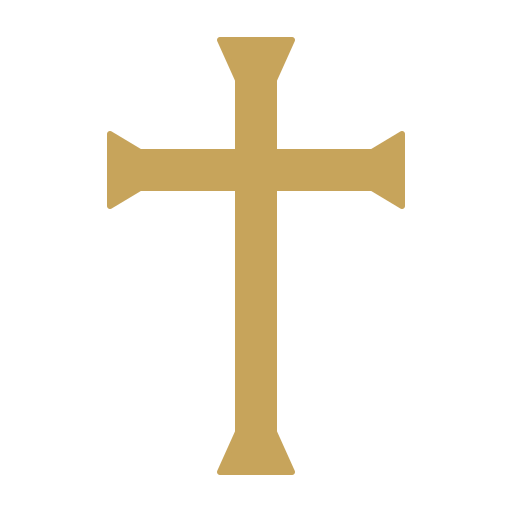
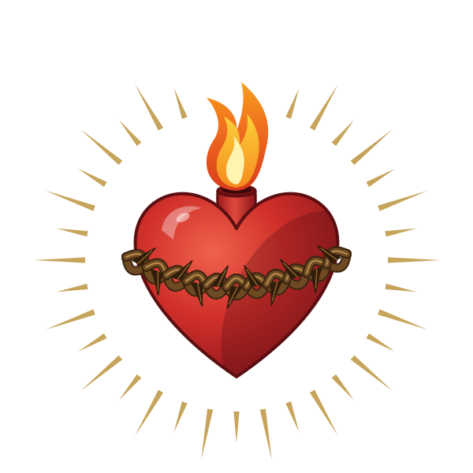
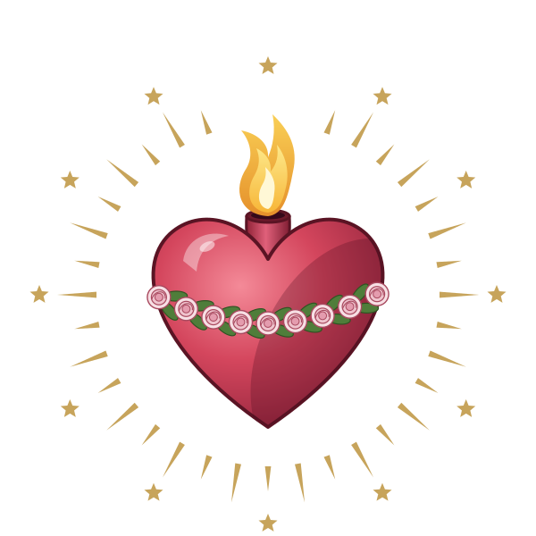
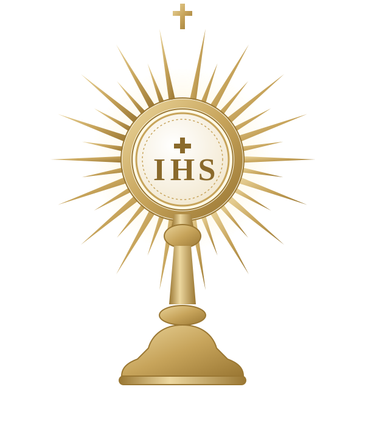
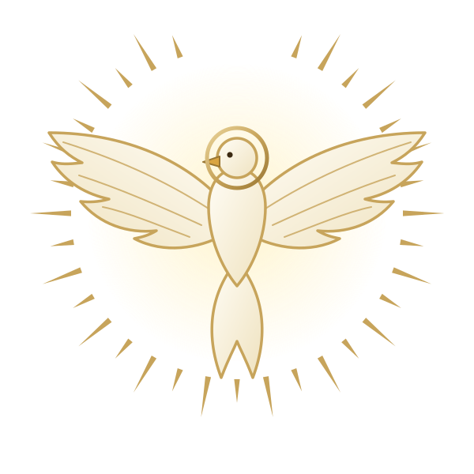
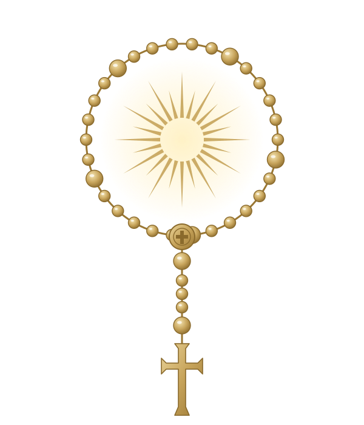
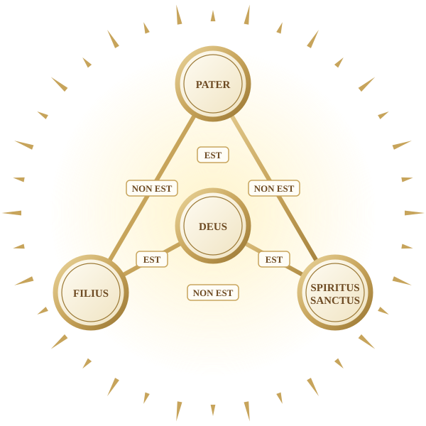
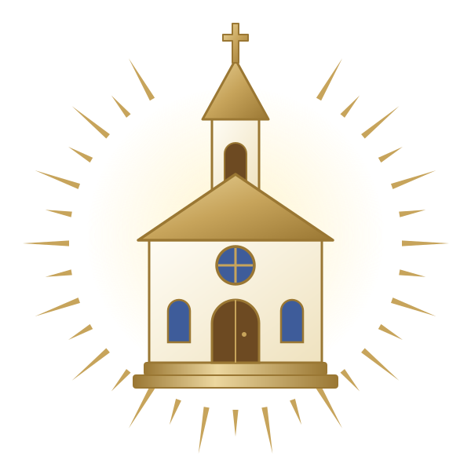
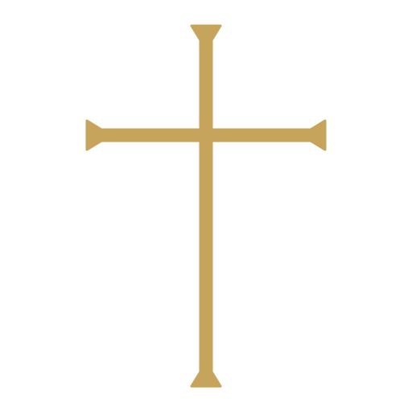

<div align="center">



# A Fé Católica

**Um só Deus, a Igreja e os santos**


<br><br>







</div>

> “Deus é o único caminho que temos certeza de que é certo.”

## ✝️ Sobre o projeto

A fé católica faz parte da história e da cultura do Brasil, mas muita gente, inclusive quem foi batizado, conhece pouco do que a Igreja realmente ensina. Este projeto nasceu para ajudar a preencher essa lacuna.

O objetivo não é convencer ninguém a seguir uma religião. A proposta é informar com clareza e respeito, mostrando em que os católicos acreditam e como essa fé é vivida no dia a dia, sempre com base em fontes oficiais da Igreja.

O tema vem de uma experiência pessoal: o autor foi batizado na infância, mas só neste ano passou a viver a fé de verdade, a partir da catequese e da preparação para a Crisma. A história dessa aproximação, de quem acreditava em Deus e passou a buscá-lo, é contada em formato de storytelling e liga o conteúdo à vida real.

## 🕊️ O tema

<table>
  <tr>
    <td align="center" width="110"></td>
    <td><b>Um só Deus</b><br>Os católicos acreditam em um único Deus, em três Pessoas: Pai, Filho e Espírito Santo.</td>
  </tr>
  <tr>
    <td align="center"></td>
    <td><b>A Igreja e os sacramentos</b><br>A comunidade de fiéis e os sinais por meio dos quais Deus oferece a sua graça.</td>
  </tr>
  <tr>
    <td align="center"></td>
    <td><b>Maria e os santos</b><br>Modelos de vida cristã e amigos que rezam por nós. Eles são venerados, mas somente Deus é adorado.</td>
  </tr>
  <tr>
    <td align="center"></td>
    <td><b>A vida de oração</b><br>A Missa, o Terço e a oração pessoal como caminho de aproximação de Deus.</td>
  </tr>
</table>

## 🌹 Testemunhos que inspiram

<table>
  <tr>
    <td align="center" width="230"></td>
    <td>
      <b>Chiara Corbella Petrillo (1984–2012)</b><br>
      Jovem esposa e mãe de Roma, reconhecida pela Igreja como Serva de Deus. O seu testemunho de fé vivida no matrimônio e na maternidade inspira este projeto.
    </td>
  </tr>
</table>

**Santo Agostinho (354–430)**, bispo de Hipona e Doutor da Igreja, viveu distante da fé até se converter. A sua história, de quem estava longe e se aproximou de Deus, conversa com a caminhada que este projeto conta.

## 🎨 Identidade visual

Os logos seguem um estilo dourado, com a cor principal **#c7a45b**, e estão em SVG (vetorial), com fundo transparente.

<table>
  <tr>
    <td align="center"><br><sub>Cruz</sub></td>
    <td align="center"><br><sub>Cruz fina</sub></td>
    <td align="center"><br><sub>Sagrado Coração</sub></td>
    <td align="center"><br><sub>Imaculado Coração de Maria</sub></td>
    <td align="center"><br><sub>Eucaristia</sub></td>
    <td align="center"><br><sub>Espírito Santo</sub></td>
    <td align="center"><br><sub>Terço</sub></td>
  </tr>
</table>

<details>
<summary>Significado de cada logo</summary>

| Logo | Significado |
|---|---|
| Cruz e cruz fina | Sinal do cristão e símbolo da redenção por Cristo. A cruz é o logo principal do projeto. |
| Sagrado Coração | O amor de Jesus por todas as pessoas, com a chama do amor e a coroa de espinhos. |
| Imaculado Coração de Maria | O amor materno e a pureza de Maria, com rosas e doze estrelas, que lembram Ap 12,1. |
| Eucaristia | Jesus presente no pão consagrado, em uma custódia com o monograma IHS, abreviação do nome de Jesus. |
| Espírito Santo | A pomba, que lembra o Batismo de Jesus (Jo 1,32). |
| Terço | A vida de oração, representada pelo rosário. |

</details>

## 📁 Estrutura do repositório

```
Projeto-Individual-HK/
├── DOCUMENTOS_DE_APOIO/
├── public/
│   ├── assets/
│   ├── css/
│   ├── dashboard/
│   ├── HTML/
│   ├── html2/
│   └── imgs/        logos em SVG e fotos do projeto
└── README.md
```

## 🖼️ Como usar os logos

Nas páginas dentro de `public/HTML`, o caminho precisa subir uma pasta:

```html

```

No CSS, dentro de `public/css`, vale a mesma regra: `url('../imgs/logo-cruz.svg')`.

Os SVGs escalam sem perder qualidade e têm fundo transparente, então funcionam em fundos claros e escuros.

## 🔗 Fontes principais

- [Catecismo da Igreja Católica (Vaticano)](http://www.vatican.va/archive/cathechism_po/index_new/prima-pagina-cic_po.html)
- [Compêndio do Catecismo da Igreja Católica](https://www.vatican.va/content/benedict-xvi/pt/motu_proprio/documents/hf_ben-xvi_motu-proprio_20050628_compendio-catechismo.html)
- [Padre Paulo Ricardo](https://padrepauloricardo.org)

## ✍️ Autor

Kevin Alves Silva, curso de Análise e Desenvolvimento de Sistemas, São Paulo Tech School.
